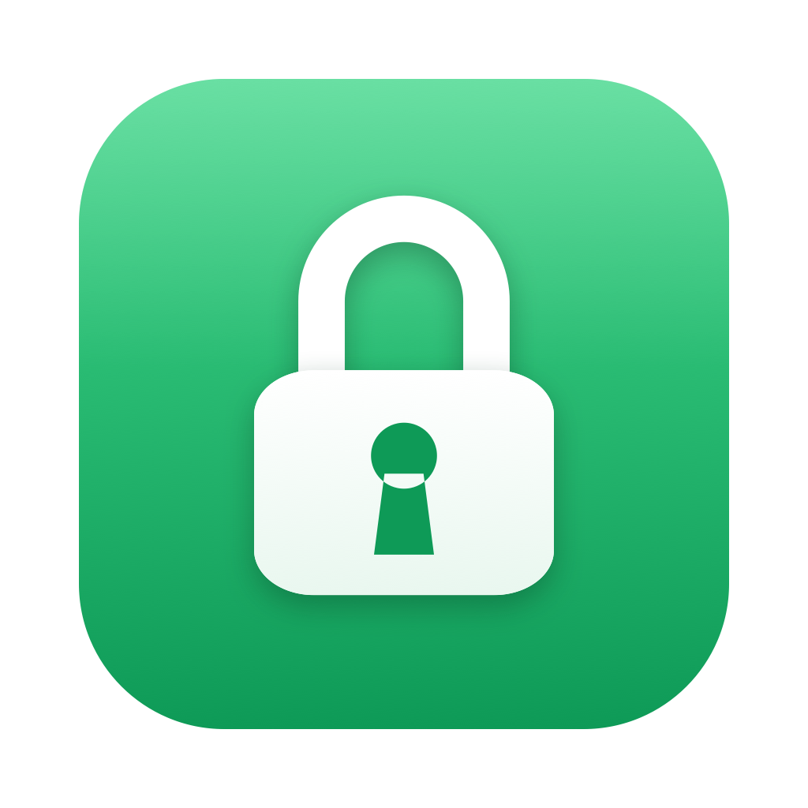
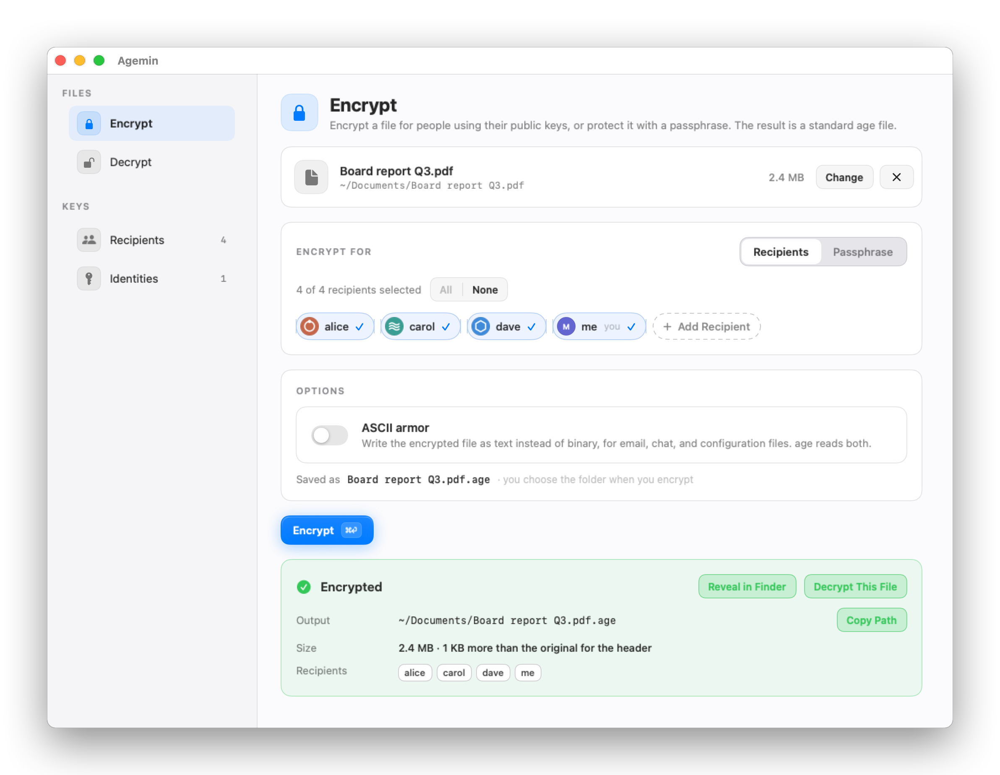

  

<h1 align="center">Agemin</h1>

<strong>age encryption, without the terminal.</strong>

  Encrypt files for people using their SSH or age public keys, or protect them with a passphrase. Decrypt files sent to you with your own keys. Agemin reads and writes the standard <a href="https://age-encryption.org/">age</a> format in a native Mac app, with nothing else to install.

  <a href="https://min.tools/agemin">Website</a>&nbsp;&nbsp;|&nbsp;&nbsp;
  <a href="https://min.tools/agemin/support/">Support</a>&nbsp;&nbsp;|&nbsp;&nbsp;
  <a href="PRIVACY.md">Privacy</a>&nbsp;&nbsp;|&nbsp;&nbsp;
  <a href="docs/development.md">Build</a>&nbsp;&nbsp;|&nbsp;&nbsp;
  <a href="docs/architecture.md">Architecture</a>

  
  
  
  
  
  
  

  <picture>
    <source media="(prefers-color-scheme: dark)" srcset="docs/images/hero-dark.png">
    
  </picture>

- **The keys you already have**

  Encrypt for `ssh-ed25519` and `ssh-rsa` public keys straight from `.pub` files, or for age keys. One `.pub` file per recipient in a folder of your choice, usually `~/.age`. Tick who can open each file.
- **Decrypt with your SSH key**

  Agemin finds private keys in your identities folder, usually `~/.ssh`, and in age identity files you add. It shows which keys match a file before you decrypt it and asks for the passphrase of a protected key when needed.
- **Passphrases too**

  Protect a file with a passphrase instead of keys, and open files others protected that way. age stretches passphrases with scrypt. Agemin can generate a strong one for you.
- **Standard age files**

  Files Agemin writes open with the `age` command line tool and other age software, and Agemin opens theirs. Binary or ASCII armor, large files included.
- **Private, complete results**

  Output files are readable only by your account, a failed or canceled run leaves no partial file behind, and a decrypted file comes with its SHA-256 checksum.
- **Keys without the terminal**

  Add a recipient by pasting a key, create a new age key pair, see fingerprints, and reveal any file in Finder.
- **Avatars for keys**

  Give each key an avatar: one of twelve drawn symbols, initials in a color, or an image of your own. Recipients then appear as chips you tick, with your own key marked. Avatars live in the app container, keyed by fingerprint. The key folders never change.
- **Sandboxed and offline**

  Agemin reads only the folders and files you choose, never runs a command, and has no network entitlement.
- **In your language**

  Agemin follows your Mac's language settings and ships in 31 languages.

## Get started

1. Open Agemin and choose your recipients folder, usually `~/.age`, and your identities folder, usually `~/.ssh`.
2. Drop a file on the Encrypt page, tick the recipients, and press **Encrypt** or ⌘⏎.
3. To open an age file, drop it on the Decrypt page. Agemin picks the matching key.

> [!NOTE]
> Agemin requires an Apple silicon Mac with macOS 14 or later. It implements the age format itself, so the `age` command line tool is not needed. Files written by either open with the other.

## What Agemin reads

| Key | Use |
| --- | --- |
| `age1…` public keys and `ssh-ed25519` and `ssh-rsa` public keys | Recipients, from `.pub` files |
| `AGE-SECRET-KEY-1…` identity files, including files age-keygen wrote | Identities |
| OpenSSH private keys for Ed25519 and RSA, with or without a passphrase | Identities. Protected keys ask for their passphrase |
| Legacy PEM RSA private keys without a passphrase | Identities |
| age identity files encrypted with a passphrase | Identities, after the passphrase |
| Passphrases | Encrypting and decrypting with scrypt |

ECDSA, DSA, and security-key (`sk-`) SSH keys are not supported by age. Keys from age plugins (`age-plugin-*`) are not supported in this version.

## Private by design

Agemin has no advertising, analytics, account system, or developer server, and it has no network entitlement. Its app container holds the security-scoped bookmarks that reopen your key folders, your avatar choices, the trial state and daily count, and the window position. Agemin does not copy keys or input files into its container or log them. Passphrases are never stored. Read [Privacy](PRIVACY.md) for the details.

## One app, two ways to use it

**Mac App Store:** The free download includes 30 days of full access. No subscription starts, and you are not charged. After the trial, Agemin still encrypts or decrypts one file per day. Reading keys, inspecting files, and creating keys stay unlimited. Agemin Pro removes the daily limit, as a yearly subscription or a lifetime purchase.

**Build from source:** This repository holds the public app source. A source build starts the same 30-day trial on a local clock after the first-launch notice. The Mac App Store build counts from Apple's signed original acquisition date. Both apply the same daily limit, StoreKit checks, and post-trial banner. See [Build and test](docs/development.md).

If Agemin helps you, [contribute](CONTRIBUTING.md) to its development.

## Documentation

| Guide | What it covers |
| --- | --- |
| [Build and test](docs/development.md) | Source and App Store builds, tests, generated assets, and source export |
| [Architecture](docs/architecture.md) | Builds and Pro access, file access and the sandbox, the age implementation, the interface, localization, and appearance |
| [Privacy](PRIVACY.md) | Local data, retention, and controls |
| [Third-party notices](THIRD_PARTY_NOTICES.md) | Licenses for the OpenBSD and OpenSSH code Agemin builds on |

## License

Copyright 2026 [Ilia Ross](https://github.com/iliaross). The original Agemin source is available under the [PolyForm Strict License 1.0.0 with added permissions for personal modification and contributions](LICENSE). You may inspect, build, and run it for noncommercial purposes, modify it for your own personal, noncommercial use, and prepare a contribution to the official repository under the [contribution terms](CONTRIBUTING.md). The repository license does not otherwise permit distributing the source, modified copies, or binaries. Third-party portions remain under the licenses in [Third-Party Notices](THIRD_PARTY_NOTICES.md). The Min Tools name, the Agemin name, and the Agemin icon are not licensed. The Mac App Store build follows Apple's [standard EULA](https://www.apple.com/legal/internet-services/itunes/dev/stdeula/).
